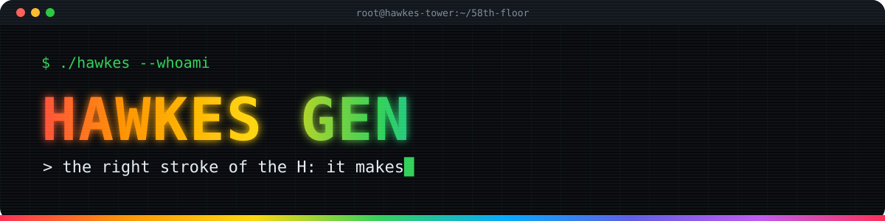

<div align="center">



<a href="https://hawkesgen.ai"></a> <a href="https://github.com/jgriffith3433/hawkesgen"></a> <a href="https://github.com/jgriffith3433/hawkesgen"></a> <a href="https://hawkesbiomedical.com"></a>

### 🌈 **THE RIGHT STROKE OF THE H: IT MAKES** 🌈

</div>


## ⚡ `$ cat WHOAMI`

> **Gen turns requests into files. Every request is a job spec; one queue gives each project a fair turn and batches by model; a router tries GPU providers in order; every result is kept by its content, with the recipe that made it.**

```diff
+ repo     hawkesgen
+ live     https://hawkesgen.ai
+ stack    Node 24 · TypeScript · Cloud Run · ComfyUI on RunPod and Modal
+ part of  the Hawkes universe: 9 products, 3 engines, one H
```


## 🧬 **THE H** · the whole machine on one screen

```
   ░░ WHO ASKS STUDIO ░░                         ░░ WHO ASKS GEN ░░
   the owner · testers · the clock               editors · game tools · the portal
              │                                               │
   ┏━━━━━━━━━━▼━━━━━━━━━━┓      jobs ━━━━━▶      ┏━━━━━━━━━━━━▼━━━━━━━━━━━━┓
   ┃   HAWKES  STUDIO    ┃                       ┃       HAWKES  GEN       ┃
   ┃   decides           ┃      ◀━━━━━ evidence  ┃       makes             ┃
   ┃   tasks · judges    ┃                       ┃   queue · router · lib  ┃
   ┗━━━━━━━━━━┳━━━━━━━━━━┛                       ┗━━━━━━━━━━━━┳━━━━━━━━━━━━┛
              ▼                                               ▼
   ░ six AI harnesses ░                          ░ rented GPUs · CPUs · browsers ░
   commits ▶ dev ▶ beta ▶ main ▶ 🌐 live          files kept forever, by their content
```

**One side decides, one side makes, and they meet in exactly one place.** Files never cross the bar, only their ids. Nothing ships until evidence about that exact commit has come back.


## 💊 **THE PRODUCT LINE** · presented as medicine, played as games

| Product | Sold as | Live | Repo |
|:--|:--|:--|:--|
| Hawkes Biomedical | *the parent company* | [hawkesbiomedical.com](https://hawkesbiomedical.com) | [`hawkesbiomedical`](https://github.com/jgriffith3433/hawkesbiomedical) |
| PH Origins | *pH balance* | [phorigins.com](https://phorigins.com) | [`phoriginswebsite`](https://github.com/jgriffith3433/phoriginswebsite) |
| Sick Of It | *single-use fever shots* | [sickofitgame.com](https://sickofitgame.com) | [`sickofitgamewebsite`](https://github.com/jgriffith3433/sickofitgamewebsite) |
| Dose Of Destruction | *cytotoxic dose* | [doseofdestruction.com](https://doseofdestruction.com) | [`doseofdestructionwebsite`](https://github.com/jgriffith3433/doseofdestructionwebsite) |
| Yooba Land | *hyporexia support* | [yoobalandgame.com](https://yoobalandgame.com) | [`YoobaLandGame`](https://github.com/jgriffith3433/YoobaLandGame) |
| I Can Be | *AI-assisted full-body assessment* | [icanbe.ai](https://icanbe.ai) | [`icanbeaiwebsite`](https://github.com/jgriffith3433/icanbeaiwebsite) |
| The Place Department | *HIPAA-compliant document storage* | [theplacedepartment.com](https://theplacedepartment.com) | [`theplacedepartmentwebsite`](https://github.com/jgriffith3433/theplacedepartmentwebsite) |
| Imagine Live TV | *live medical education* | [imaginelivetv.com](https://imaginelivetv.com) | [`imaginelivetvwebsite`](https://github.com/jgriffith3433/imaginelivetvwebsite) |
| Hawkes Games | *laboratory services* | [hawkesgames.com](https://hawkesgames.com) | [`hawkesgenwebsite`](https://github.com/jgriffith3433/hawkesgenwebsite) |

## 🛠️ **THE ENGINES** · infrastructure, not products

| Engine | Verb | What it is | Live |
|:--|:--|:--|:--|
| Hawkes Studio | **decides** | the manager: Talk, the roadmap, AI agents, playtests, judges, the gate to live | [studio.hawkesgen.ai](https://studio.hawkesgen.ai) |
| **➤ Hawkes Gen** | **makes** | the maker: one job queue, ~100 generative tools, rented GPUs, a library kept by content hash | [hawkesgen.ai](https://hawkesgen.ai) |
| Hawkes Net | **connects** | multiplayer: tickets, rooms, peer-to-peer with a relay behind it | [net.hawkesgen.ai](https://net.hawkesgen.ai) |


## 🚦 **THE LANES**

```
  dev ──▶ beta ──▶ main
  │       │        └─ 🌐 the live site. Moves only on the owner's word.
  │       └─ 🧪 a private copy, played and judged before anything ships
  └─ 💻 where work happens
```

Every repo has the same six buttons: `dev.bat` · `deploy-beta.bat` · `deploy-prod.bat` · `status.bat` · `links.bat` · `sync.bat`. Addresses and commands for this repo are in [`LANES.md`](LANES.md); the rules for agents are in [`AGENTS.md`](AGENTS.md).


## 📜 **THIS REPO** · the original README, kept

The generative R&D floor of Hawkes Biomedical: one local service that every game and site uses for custom
generative AI, so projects never deal with GPU servers, ComfyUI, models or API keys.

- **A Unity build server on AWS** (Windows, Unity 6 + WebGL) that keeps every project's Library, so WebGL builds are
  incremental. Hawkes Studio (`C:\Projects\hawkesstudio`) drives it with the playtest and review tools every day.
- **A GPU fleet on AWS running ComfyUI.** Hawkes Gen launches, starts and stops the servers and shares them
  between projects through one queue. It installs each workflow's models the first time a job needs them,
  and frees disk when space runs short. Queued GPU jobs start stopped servers by themselves (`fleet.auto`;
  launching new ones needs `fleet.autoLaunch`, off).
- **Workflows as data.** Any ComfyUI workflow becomes a tool: browse ComfyUI's 245 open-source templates
  (or drop in your own export) and import it. Its inputs, prompts, seeds, sizes, outputs and model download
  links are found for you.
- **Open audio models** on the GPU fleet for voices, sound effects and music (the default); **ElevenLabs** is secondary, only when a call asks for it. **Claude** for writing, JSON designs and art review.
- **Local tools** on this PC: cutouts, framing, seamless tiling, material maps, video prep.
- **Presets**: each project's art direction (a style line plus named recipes), shared by games, agents and
  people.
- **A library** of everything made, with the recipe that made it, browsable across projects.
- **Usage and cost** per project and per API key.
- **Player analytics** for every product: its own collect door, GeoIP and user agents on the server (no IP kept),
  sessions, funnels, drop-off, retention, levels, errors, perf, builds side by side and plain-sentence insights
  (`docs/analytics.md`). Pages add one script tag (`/sdk/analytics@1.js`); Unity WebGL games add the
  `com.hawkes.analytics` package.
- **Clients for everything:**
  - JS and Python libraries
  - a Unity editor package
  - a CLI
  - an MCP server, so Claude Code (or any agent) in any project folder can use it directly

## Start

```bash
auto-start.bat
```

This opens Hawkes Gen at http://127.0.0.1:8790: the app at `/` (Create, Library, Editor, on Gen's own accounts) and the
admin dashboard at `/admin`. The first run installs Node packages and a Python `.venv`.
Keys go in `.env` (see `.env.example`). The dashboard has these tabs:
- Overview
- Jobs
- Library (with 3D previews)
- GPU fleet (servers, models per server, costs)
- Tools (try any tool)
- Presets
- Workflows (the template library and your workflows)
- Usage
- Settings (API keys)

## Tools

| Area | Tools |
|---|---|
| Images | `image.generate` (Z-Image Turbo text-to-image; `seamless` for textures), `image.edit` (Qwen-Image-Edit), `image.repaint` ("Repaint an area": change only what a mask marks, every other pixel kept), `image.expand` ("Expand the picture": grow the canvas by px per side or to an aspect like 16:9, the scene continued into it), `image.paint` (paint styled on references), `image.control` (paint over a render or sketch with ControlNet: grey-box to finished art), `image.relight`, `image.angles` (a character from 8 camera angles), `image.upscale` (Real-ESRGAN), `image.restore` (SeedVR2, finer), `image.panorama` (360° skies) |
| Characters | `lora.train` (train a character LoRA on its poses, with per-image captions or Claude-written ones, on the GPU fleet), `image.character` (draw that character on-model in any pose or scene) |
| Analysis and masks | `image.remove-background` (BiRefNet on the GPU), `image.segment` (SAM 3, find by text), `image.layers` (split into RGBA layers), `image.pose` / `video.pose` (SDPose whole-body pose maps), `image.depth` (Depth Anything 3), `image.normals` and `image.albedo` (Marigold v2) |
| Video | `video.i2v` (Wan 2.2 image-to-video and first-last-frame loops), `video.animate` and `video.motion` (motion transfer; Wan Animate 2), `video.talk` (InfiniteTalk: a character speaks or sings a voice track), `video.t2v` (Wan 2.2 text-to-video), `video.control` (repaint a control video, depth, pose or edges, in any look, with sound; LTX-2.3 IC-LoRA) and `video.control-wan` (Wan 2.2 Fun Control), `video.upscale`, `video.interpolate` (FILM), `video.change` ("Change something in a video": the first frame edited, masked or whole, then `video.control` carries the change through the clip with the original motion and sound; a pipeline of child jobs) |
| Blender | `blender.render` (a Blender shot on a GPU server: a .blend, or characters with a timeline of beats (feet matched to the ground), props in their hands, a PBR set, muzzle flashes and flashlights, a sky and a camera move built from files; returns the render plus depth, pose, edges, normal, mask and per-character matte videos for `video.control`, and stills) |
| Film | `film.gate` (four eevee frames as a contact sheet judged by Claude Vision against a strict rubric, adjusted and re-checked before any ComfyUI spend), `film.plan` (the cinema pass, dialogue close-up, layered VFX, character LoRA and trailer recipes for `asset.make`, linted and priced), `video.matte`, `video.composite` (an effect on one character with glow, never over another's face) and `video.control-mix` (depth + pose + edges as one control): `docs/film-pipeline.md` |
| 3D | **always more than one view:** `image.viewsheet` (the back, left and right of a character from its front view, checked by Claude, laid out as a sheet) then `mesh.views3d` (Pixal3D multi-view + TRELLIS 2 with PBR textures, from a front/back/left/right sheet). Deprecated, refusing a single image unless `allowSingleView: true` (props only): `mesh.from-image` (Hunyuan3D 2.1 shape), `mesh.from-views` (Hunyuan3D multi-view: front + side), `mesh.textured` (Pixal3D / TRELLIS 2 from one image). Then `mesh.rig` (rig and skin a GLB on a GPU worker with the 3D image or the fleet: Make-It-Animatable for a humanoid, Mixamo bone names; SkinTokens otherwise; a rigged FBX and GLB plus a walk preview. Its own venv, installed on first use), `motion.from-text` (a humanoid clip from a sentence: Kimodo on the SOMA skeleton, HY-Motion as fallback, retargeted onto a rig, with key poses and several takes, each measured), `motion.from-video` (motion capture from an ordinary video: NVIDIA GEM-X, the same SOMA BVH, retargeted onto a rig), `motion.check` (foot slide, ground, pops, jitter, loop seam of a BVH; free), `blender.character` (named Blender ops on a 3D character in one job: clean and decimate, bake UVs and maps, attach a prop to a bone, retarget clips across skeletons, clip edits and key poses from JSON, hard-surface robots — split / template / procedural clips — FBX for Unity and GLB for the web, preview videos) |
| Hawkes Net | Multiplayer for every game: one client SDK (`join(room, { project, transport: 'auto' \| 'p2p' \| 'relay' })`: send/on, avatars, state sync, ownership, shared clock, reconnect), WebRTC host-star for small rooms, relay nodes for big ones (its own service, box and repo, `jgriffith3433/hawkesnet`: https://net.hawkesgen.ai; more relay boxes run `node net/src/node.ts`), rooms that move between them without the game noticing, binary protocol 3 (~5x smaller than JSON), signed join tickets (`POST /v1/net/ticket`: a key, or the project's own sites), publish from servers, usage per project. SDK at `https://net.hawkesgen.ai/sdk/hawkes-net@1.mjs`, demo `https://net.hawkesgen.ai/`, `docs/net.md` |
| Audio | **Open models first, ElevenLabs second** (`docs/audio.md`): `audio.voice` (speak with direction, a saved Gen voice or a cloned sample), `audio.voice-design` + `audio.voice-save` + `audio.voice-clone` (the Gen voice library, no slot cap), `audio.dialogue` (table read with stems and timings), `audio.sfx` (variants, seamless loops), each running the open models unless the call says `provider: "elevenlabs"` (or carries an ElevenLabs voice id, old content); the open twins `audio.voice-open`, `audio.sfx-open`, `audio.dialogue-open`, `audio.voice-design-open`, `audio.voice-save-open`, `audio.voice-list-open`, `audio.voice-delete-open`; free post-processing and checks `audio.process`, `audio.analyze`, `audio.music-loop`; `audio.music` (ACE-Step 1.5 XL songs and loops); `audio.voice-list` + `audio.voice-delete` (the Gen voice library by default) and `audio.voice-change` (ElevenLabs only, no open model yet); `audio.transcribe` (faster-whisper on a GPU server) and `audio.revoice` ("Give it a new voice": transcribe, speak it again in a voice described in words or a Gen voice, fit it to the original timing, put it back on the video; open models). `node tools/audition.mjs` compares models side by side |
| Language | `llm.text` and `llm.json` (Claude, with images for vision) |
| On this PC | `video.compose` (shots into a finished cut: order, trims, cuts and crossfades, each shot's sound, music and voice ducked under dialogue, captions; a web mp4, a .vtt and a poster; ffmpeg, free), `image.cutout`, `image.frame`, `image.tile`, `texture.maps`, `video.fit`, `media.probe`, `file.import` (a file into the library as it is), `video.frame` (one frame as an image: a time, "first" or the true "last"), `video.still` (an image as an H.264 clip, optional push-in, for the timeline), `media.normalize` (any upload to an H.264/AAC MP4, PNG/JPEG or MP3; uploads that need it are queued for it) |
| Builds | `unity.build` (Unity WebGL on the AWS build server, incremental: keeps each project's Library) |
| Playtests | `playtest.run` (play a game in Chromium through its playtest contract, or smoke-test or crawl a site; video, screenshots, console, fps), `playtest.review` (Claude watches it and files a few new findings: capped, told the known ones, a mode per run kind, judged against the product's quality bar; it also watches short 15 fps stretches of the video and its hitches) |
| Pipelines | `asset.make` (a chain of tools as one recipe; best-of-N images or videos, at any step, picked by Claude against the art direction, canon and on-model references; takes the library already has are reused) |
| Library | Entities (a fighter, a stage, a shot) with slots (concept, side, pose/air, clip/jab) and every version of each (takes, current, old): make, revise with feedback, pick, live events, and `slot:` references in any job. One API for every product's tools, Studio, Unity and Claude: `docs/library.md` |
| Anything else | `comfy.graph` (run a raw graph), or import a workflow (dashboard → Workflows) |

## Use it

**From an agent** (Claude Code, Cursor): every project folder's `.mcp.json` has the `hawkesgen` server.
- Ask for "a seamless lab-tile texture for PH Origins". The agent reads the project's presets and runs the tool.
- MCP tools: `hawkesgen_tools`, `hawkesgen_run`, `hawkesgen_presets`, `hawkesgen_library`, `hawkesgen_jobs`,
  `hawkesgen_job`, `hawkesgen_cancel`, `hawkesgen_fleet`, `hawkesgen_estimate` (what a batch costs, before starting servers), `hawkesgen_templates`, `hawkesgen_import_workflow`.

**From the command line:**

```bash
hawkesgen.cmd tools
hawkesgen.cmd run - --project phorigins --preset sky --param prompt="night city from the 58th floor, rain" --out out/
hawkesgen.cmd run image.generate --project sandbox --param prompt="cracked hospital tiles" --param seamless=true --out out/
hawkesgen.cmd fleet status
hawkesgen.cmd fleet image status          # the machine image new servers launch from (build | prune | cancel)
```

**From code** (copy `clients/js/hawkesgen.mjs` or `clients/python/hawkesgen.py` into the project):

```js
import { HawkesGen } from './hawkesgen.mjs';
const gen = new HawkesGen({ project: 'sickofit' });
const job = await gen.run(null, { preset: 'enemy-concept', params: { prompt: 'a hell imp with an ember' } });
await gen.download(job.outputs[0].asset, 'imp.png');
```

**From Unity:** add `"com.hawkes.gen": "file:C:/Projects/hawkesgen/clients/unity/com.hawkes.gen"` to
`Packages/manifest.json`, then open Window > Hawkes Gen. Results import into `Assets/HawkesGen/`.

**Player analytics on a page** (`clients/js/hawkes-analytics.js`; the quick start is in `docs/analytics.md`):

```html
<script src="https://hawkesgen.ai/sdk/analytics@1.js" data-product="sickofit" data-build="1.4.2" defer></script>
<script>hawkesAnalytics.levelStart(1); /* … */ hawkesAnalytics.levelEnd(1, 'complete');</script>
```

**Player analytics in a Unity WebGL game:** add `"com.hawkes.analytics": "file:C:/Projects/hawkesgen/clients/unity/com.hawkes.analytics"`,
create `Assets/Resources/HawkesAnalyticsSettings.asset` (Assets > Create > Hawkes > Analytics Settings, set the
product), and call `Hawkes.HawkesAnalytics.LevelStart("1")` and friends. The website needs no change: the bridge
loads the SDK into the page.

## Docs

| File | What |
|---|---|
| `AGENTS.md` | How it's built, the rules, adding tools |
| `docs/workflows.md` | Turning ComfyUI workflows into tools, and the manifest format |
| `docs/api.md` | Every API route |
| `docs/comfyui.md` | What works on the GPU servers (and what hangs them) |
| `docs/library.md` | The library: entities, slots, versions, and how a product's tools use it |
| `docs/analytics.md` | Player analytics: the event contract every product follows, the collect door, the query API |
| `docs/net.md` | Hawkes Net: what's built and how to use it, the measured numbers, then the design (protocol, tickets, hosting, cost per 1,000 players) |
| `docs/blender.md` | Blender shots to video: `blender.render`, the shot format, `video.control`, and the cut (`video.compose`); rigging a generated character (`mesh.rig`) |
| `docs/film-pipeline.md` | The film pipeline: the director gate, the cinema pass, dialogue close-ups, layered VFX, character LoRAs, the trailer cut, what a trailer costs |
| `docs/3d-animation.md` | Where the 3D tools run (the 3D worker image on RunPod/Modal, or the fleet), setting up the 3D endpoint, `motion.from-video`, `motion.check`, the `animation` intent, the MCP tools, engines |
| `docs/3d-characters.md` | `blender.character`: every op (clean, bake, attach, retarget and its bone-name schemes, clip edits, key poses, robot split/template/clips, FBX/GLB exports, previews), the library kind `character3d`, the CC0 Quaternius motion library, and `motion.from-text` |
| `DESIGN.md` | J's decisions and the roadmap |


<div align="center">

**🏢 Hawkes Tower · 58th floor · "We do not pitch a cure. We own the category."**

<sub>Hawkes Biomedical and every product in its line are a work of fiction. Built by one person and a great many agents.</sub>

</div>
